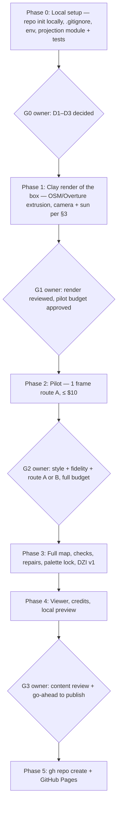

# Casablanca Pixel Art Map (Tiny Casablanca)
## Architecture & Implementation Plan — v2 (revised 2026-10-27)

> **Status: NOT signed off for full execution.** Phase 0 (local, no-cost setup) may start once the owner
> answers decisions **D1–D3** in §9. Every paid call, any use of third-party imagery, repo creation and
> publishing need the owner's explicit go-ahead at the gates in §8.
> Original plan backed up at `_archive/PLANNING_v1_original_2026-10-27.md`.
> Facts about tools, models, prices and licences are dated; re-check them if more than ~30 days old.

---

### 1. Objective
An interactive, isometric pixel-art map of **downtown Casablanca (Centre-Ville)**, Morocco, in the spirit of
Andy Coenen's **isometric.nyc** and Boris Starkov's **tiny.london** (`res/tiny.londo.Explanation.txt`).
Target area: **Place des Nations Unies**, the **Tour de l'Horloge**, **Place Mohammed V** (with the Wilaya, the
Grand Théâtre and the French Consulate), **Boulevard Mohammed V** as far as the **Marché Central**, and
**Bab Marrakech** at the edge of the Ancienne Médina.

What we take from tiny.london, and what we do not:
- **Take:** one orthographic camera for the whole map; "describe how to draw, not what to draw"; ground-truth
  checks (render for structure, OpenStreetMap for water and roads); resumable stages; immutable published versions.
- **Do not take blindly:** its source imagery (Google 3D Tiles; see §4, not permitted for this use) and its
  seam method, which needs a diffusion model we run ourselves. tiny.london's own first attempt, prompting
  an API model tile by tile, left visible seams on **a third of all tile boundaries** (55 of 169).

### 2. Geographic scope

**Name.** Use "Centre-Ville" / "downtown Casablanca". "Gazaplanca" is removed: it is not a recognised name for the
district and should not appear in the UI or the prompts.

**Landmark coordinates (WGS84).** OSM = OpenStreetMap via Nominatim/Overpass, queried 2026-10-27.
"Owner list" = coordinates pasted by the owner on 2026-10-27 ("local GIS records").

| # | Landmark | OSM 2026-10-27 | Owner list | Gap |
|---|---|---|---|---|
| 1 | Place des Nations Unies (square) | 33.5950 N, 7.6187 W | 33.5933 N, 7.6185 W | ~190 m |
| 2 | Tour de l'Horloge (medina clock tower, `man_made=tower`) | 33.5969 N, 7.6173 W | 33.5951 N, 7.6186 W | ~230 m |
| 3 | Place Mohammed V (square) | 33.5916 N, 7.6198 W | 33.5898 N, 7.6184 W | ~240 m |
| 4 | Wilaya de Casablanca | not found as a building; "Wilaya" bus stop 33.5904 N, 7.6194 W | 33.5893 N, 7.6191 W | ~125 m to the stop |
| 5 | Grand Théâtre de Casablanca | not found in the queries run | 33.5905 N, 7.6171 W | — |
| 6 | Bab Marrakech (`historic=city_gate`) | 33.5982 N, 7.6215 W | 33.5958 N, 7.6205 W | ~280 m |
| 7 | Marché Central | not found in the queries run | 33.5938 N, 7.6134 W | — |
| 8 | Hyatt Regency (on Place des Nations Unies) | 33.5961 N, 7.6188 W | — | — |
| 9 | Consulat général de France | 33.5900 N, 7.6180 W | — | — |
| 10 | Parc de la Ligue Arabe (extent) | 33.5849–33.5917 N, 7.6281–7.6200 W | — | — |
| 11 | Boulevard Mohammed V | runs ESE from Pl. des Nations Unies | 33.5933 N, 7.6185 W → 33.5945 N, 7.6100 W | — |

The owner list sits about 200–280 m south of OSM for the four points both sources have, and it puts Place des
Nations Unies where OSM has the Tour de l'Horloge. **Open decision D2:** which source is authoritative. Until it
is settled, the box below is drawn so that it contains **both** sets of points.

Notes on the landmarks:
- **Two different clock towers.** The **Tour de l'Horloge** is the medina-wall clock tower by Place des Nations
  Unies (OSM: 33.5969 N). The **Wilaya** has its own clock tower on Place Mohammed V, about 650 m south. Keep both
  as separate pins, and never label either one "Casablanca Clock Tower" on its own.
- Facts still to check against a citable source before they appear in the viewer: "Koubba dome" at Place des
  Nations Unies, the Grand Théâtre's architect, and the Place Mohammed V fountain.

**Bounding box (replaces v1).** v1 gave West/East as 33.6250° W / 33.6120° W, which is a latitude value typed as
a longitude (that point lies in the Atlantic, off West Africa). The longitudes are ~7.6° W.
v1's North edge (33.5980) also cut Bab Marrakech (OSM 33.5982) just outside the box.

| Edge | Value | Why |
|---|---|---|
| North | **33.6000° N** | Bab Marrakech (33.5982) + ~200 m of medina context |
| South | **33.5875° N** | Wilaya / Place Mohammed V (lowest owner point 33.5893) + the north part of Parc de la Ligue Arabe |
| West | **7.6235° W** | Bab Marrakech (7.6215 W) + ~200 m |
| East | **7.6080° W** | Bd Mohammed V east to 7.6100 W (owner list), past the Marché Central |

- Size: **1.44 km E–W × 1.39 km N–S ≈ 2.0 km²** (1° lon = 92.73 km at 33.594° N).
- Map anchor / camera target: **33.5938 N, 7.6158 W** (box centre).
- Phase 2 can grow the box. To include the Port or the Hassan II Mosque, go north and west, then re-run §6 sizing.

### 3. Camera and projection (one convention only)
v1 said "45° tilt, 15° rotation (or 45° axonometric)". Those are two different projections; a true 45°
axonometric/isometric view uses a ~35.26° elevation and a 45° azimuth. **Decision: use the isometric.nyc /
tiny.london camera, and drop the alternative.**

- **Orthographic** camera, **pitch 45°** below the horizontal.
- **Heading 15°**: the camera looks toward bearing 015° (just east of north). Screen-up ≈ N15°E, screen-right ≈ 105° (ESE).
- One camera for the whole map. Shots move by shifting the frustum, never the camera (tiny.london method).
- Projection: WGS84 → ECEF → ENU at the anchor → view. Over 1.4 km a local tangent plane is off by much
  less than 1 px. The viewer's coordinate HUD and search use the same maths in JS (one shared test vector file).
- Scale: **0.35 m per map pixel** (tiny.london used 0.293). A 5 m frontage is ~14 px wide. Heights are
  foreshortened: at 45° pitch, 1 m of height moves a point ~2.0 px up-screen (1 m × sin 45° ÷ 0.35).

**Lighting and shadows.** Casablanca is at 33.6° N on the **Atlantic** coast (v1 said "Mediterranean"; replaced).
The sun is always in the southern half of the sky at mid-day. **Decision:** mid-morning sun from the **south-east**
(azimuth ~135°, elevation ~40–45°). Shadows then fall toward **bearing ~315° (north-west)**, which on this
camera points **up-screen and to the left**: behind the buildings. The south-facing façades toward the viewer are
lit, and shadows never cover the streets in front of them. Rules:
- The sun is set **once, in the source render** (§4). The prompt must not name a shadow direction that disagrees
  with the render.
- Acceptance check: on 10 sample crops, the shadow direction in the output is within ±20° of up-left.

### 4. Source imagery (blocking decision D1)
The method needs a render with real geometry under the camera above. v1 did not say where it comes from.

| Source | Can we restyle it and publish the result? | Verdict |
|---|---|---|
| **Google Photorealistic 3D Tiles** (what tiny.london used) | **No.** The Map Tiles policies say "you must not pre-fetch, index, store, or cache any Content" and list offline use as prohibited. Maps Platform Terms §3.2.3 bar creating "content based on Google Maps Content" and using it to train or fine-tune AI models. Sources: developers.google.com/maps/documentation/tile/policies; cloud.google.com/maps-platform/terms (modified 2026-08-26), checked 2026-10-27. | **Excluded** |
| Esri World Imagery | No. Downloading, redistributing or self-hosting content is not allowed (Esri ToU summary, updated 2025-04-21). | Visual reference only |
| Mapbox Satellite | No. "Only available for use within Mapbox services" and no extracting features for commercial use (mapbox.com/imagery). | Excluded |
| **OpenStreetMap** footprints, roads, water, trees, tram line | **Yes.** A rendered image is a *Produced Work* under the ODbL and may carry any licence. Credit: "© OpenStreetMap contributors". | **Primary geometry** |
| **Overture Maps** buildings (heights where present) | Yes, ODbL. Each upstream source needs its own credit. | Adds heights |
| **Copernicus Sentinel-2** | Yes: adaptation and publishing allowed with "Contains modified Copernicus Sentinel data [year]". Resolution is ~10 m, so use it for ground colour only. | Optional ground tint |
| Owner's own photos or drone footage | Yes, if the owner holds the rights. Drone flights in Morocco need authorisation; check local rules before flying. | Landmark references |
| Wikimedia Commons photos | Per file (CC BY / CC BY-SA / PD); record each licence. | Landmark references |
| A commercial aerial or 3D city model licensed for derivatives | Possible; needs a quote and licence review. | Fallback if the OSM route lacks fidelity |

**Recommended route (default for D1): our own "clay" render.** Extrude OSM/Overture footprints to their heights
(levels × 3.2 m where height is missing). Add roof shapes for the landmarks by hand from referenced photos. Lay
down roads, tram rails, plazas, trees and water from OSM, then render with the camera and sun in §3 (three.js or
Blender). The render is ours, so storing it, training on it and publishing from it are all allowed.
The trade-off is less façade detail than Google's mesh. The prompt should therefore treat the render as structure,
and the ~10 landmarks get photo references as extra input images.

### 5. Stylisation engine (blocking decision D3)

**Model and API, verified 2026-10-27 on ai.google.dev (models, image-generation and pricing pages).**
- The official model ID is **`gemini-nano-banana-2.1`** ("Nano Banana 2.1"), not `nano-banana-2.1`. Google
  recommends it for new projects. Other current IDs: `gemini-3.1-flash-image`, `gemini-3-pro-image`.
  `gemini-2.5-flash-image` has a shutdown date of 2026-10-02 on the pricing page; do not use it.
- Standard price per image for `gemini-nano-banana-2.1`: **$0.0336 (1K), $0.0504 (2K), $0.113 (4K)**. The batch
  tier is about half that. Output up to 4K.
- **The Gemini API has no mask or inpainting parameter.** Editing works only through the prompt plus input
  images. Imagen, which had mask editing, is shut down in the Gemini API.
- All outputs carry a **SynthID** watermark. The site states that the map is AI-generated.

**Avatarity is removed.** avatarity.dev is run by Axtrelis LLC and says it is "not affiliated with, sponsored by,
or endorsed by Google LLC". The `/v1/images/generations` endpoint was not tested. Sending keys and source images to
an unverified reseller adds cost, data and availability risk for no benefit. **Use the official Gemini API** (or
Vertex AI) with the owner's own key.

**There is no local Gemini.** v1 listed a "Gemini local engine" fallback; it does not exist. The real fallback is
**Qwen-Image-Edit** (Apache 2.0, on Hugging Face) run on a rented GPU. Avoid `Qwen-Image-2.1-Turbo` for a public
site: it is under the Qwen Research License, which is not cleared for this use.

**Keys:** read from the `GEMINI_API_KEY` environment variable or a git-ignored `.env`. Never write a key to the
repo, logs, prompts or the published site. A pre-commit secret scan runs before every commit.

**Prompt (revised).** v1's palette line listed content ("zellige tiles, palm canopies, tramway rails"). That is
exactly what tiny.london found makes the model invent objects. The new prompt describes **how** to draw:
```text
FIDELITY COMES FIRST:
1. Draw exactly what the render shows, in the same positions, shapes and sizes, seen from the same camera.
2. Add nothing that is not in the render and remove nothing that is.
3. Where the render shows little detail, keep the drawing just as plain. Little detail means little detail,
   never new objects.
STYLE:
4. Isometric pixel art: crisp single-pixel edges, flat fills, 2–3 tones per surface, no photo texture, no blur,
   no anti-aliasing halos.
5. Warm, sunny palette. Keep light and shadows exactly as the render has them; do not move or add shadows.
6. No vehicles, no people, no text or labels.
{OSM sentence, generated per frame, e.g. "WATER IN THIS VIEW: none. Nothing in this view uses the water colour."}
{Landmark frames only: "The extra images are photos of the building in the centre; match its shapes and colours."}
```
Post-processing: quantise to a fixed palette (64–96 colours, one palette for the whole map, set in the pilot)
and snap to the pixel grid.

### 6. Seams and blending (corrects v1 Step 4)
v1 mixed two different ideas:
- **MultiDiffusion with tent weights and RePaint pinning** works *inside* a diffusion sampler: windows edit one
  shared latent at every denoising step. It needs a model we run ourselves.
- **An API model returns finished pixels.** Averaging two finished, independently drawn tiles with tent weights
  blends two artists' versions and produces ghosted, doubled edges. Without a mask parameter, pinning is
  impossible. Multi-band/Poisson blending fixes tone steps only; tiny.london found its seams were about meaning
  (roof patterns, tree styles), and Poisson cannot fix those.

**Sizing.** Box ≈ 2.0 km², rotated 15° and foreshortened at 45° pitch, plus ~60 m of building height: the canvas is
about **5,000 × 3,580 px**. With a 256 px band all round, it is **5,632 × 4,096 px ≈ 23 Mpx**
(tiny.london: 29.9 Gpx, about 1,300 times larger).

That small size allows a much better route than v1's 70-window lattice:

| Route | How | Seams | Calls / cost (2026-10-27 prices) |
|---|---|---|---|
| **A. Few large frames (default pilot)** | Draw the map in **2–4 frames at 4K** (each ~2,816–4,096 px across), not 1K windows. Each new frame gets its finished neighbour's strip as an input image with "continue this exactly". Join on a **graph-cut seam**: the lowest-difference path through the overlap, along streets and roof edges, then a Poisson tone correction on that seam only. | Only 1–3 seams, routed along streets, each reviewed by eye | ~4 frames × ≤3 attempts × $0.113 ≈ **$1–2**; pilot budget $10 |
| A′. 1K window lattice | v1's 1024 px / 512 stride grid = **10 × 7 = 70 windows**, joined by graph-cut, not averaging | ~117 boundaries; expect ~⅓ to fail (the tiny.london August result) | 70 × ≤3 × $0.0336 ≈ **$3–7** |
| **B. Own sampler (tiny.london method)** | Gemini as teacher for ~150–300 training pairs from our render; a LoRA on **Qwen-Image-Edit**; a joint MultiDiffusion sampler (1024 px windows, 768 px stride, second grid shifted 384 px, tent weights flat in the middle 512 px), with RePaint pinning for repairs. | None by construction | Teacher ≈ 300 × 1.5 × $0.0336 ≈ **$15**; GPU ≈ 4 h training + <1 h for the 23 Mpx map. GPU price not checked; get a quote at G2. |

**Plan:** pilot route A on one 4K frame. If its fidelity and seams pass §10, finish with A. If 4K frames lose detail
(the model may draw at a lower internal resolution), or seams fail review, move to B. Never fall back to averaging
finished tiles.

**Checks for every frame (from tiny.london), each with ground truth:**
- **Structure:** edge correlation with the render is at or above a threshold set in the pilot.
- **Photo-copy:** share of flat 3×3 neighbourhoods ≥ 0.42. tiny.london's careful redraws scored 0.42–0.55 and its
  half-copies 0.18–0.35.
- **Invented water:** none outside OSM water polygons (Parc de la Ligue Arabe pools and fountains only).
- **Shadows:** direction within ±20° of up-left.
- Failed frames are redrawn up to 3 times, then flagged for the owner.

### 7. Pyramid, viewer and hosting

**DZI pyramid.** 5,632 × 4,096 px with **512 px** tiles gives an 11 × 8 grid at full resolution. DZI levels run
down to 1 × 1 px, so there are **14 levels** (0–13). v1's "Level 0 ≈ 256 × 256 thumbnail" is not how DZI counts.
There are about 120 tiles in total.
- Use **lossless WebP**. Lossy q95 smears single-pixel edges in pixel art.
- Expect well under 50 MB in total.
- Each published version goes in its own folder (`tiles/v{N}/`) and is never overwritten.

**Viewer.** OpenSeadragon **v6.1.1** (released 2026-09-09, BSD-3-Clause), pinned to that exact version.
- Nearest-neighbour rendering must be set through OpenSeadragon's drawer options. CSS `image-rendering: pixelated`
  does not affect canvas or WebGL drawing. Confirm the exact option on v6.1.1 in Phase 3.
- Pixel-exact at 1:1 and closer; smooth when zoomed out (tiny.london lesson).

**Viewer scope.**
- **v1 (in scope):** landmark pins (both clock towers as separate pins); landmark list with fly-to; coordinate and
  scale readout using the §3 maths; minimap; pixel-grid toggle; mobile layout; credits and AI-disclosure panel.
- **Later:** Day/Sunset/Night colour overlays. A tinted day map does not read as night, so do them properly or not at all.

**Credits required on the site:**
- © OpenStreetMap contributors (ODbL), plus the Overture source credits.
- "Contains modified Copernicus Sentinel data", if Sentinel-2 is used.
- Photo credits for every landmark reference image.
- "Pixel art generated with Google Gemini (SynthID-watermarked)".
- isometric.nyc (MIT) if any of its code is reused.

**Hosting.** GitHub Pages limits (docs.github.com, checked 2026-10-27):
- The published site may be no larger than **1 GB** (a hard limit).
- The source repo has a recommended limit of 1 GB.
- Bandwidth has a soft limit of 100 GB/month.
- GitHub blocks files over 100 MiB.

The map fits easily, but the render source and intermediates stay **out of the repo**, kept local or in release
assets. If traffic grows, move the tiles to object storage with immutable cache headers.

### 8. Phased roadmap with gates

- **No outward-facing step without the owner's explicit go-ahead at G3.** That covers `gh repo create`, the repo
  name, public vs private, `loumizhu` vs another account (run `gh auth status` first), and Pages publishing.
  The target URL `https://loumizhu.github.io/casablanca-pixel-map` is a proposal, not a decision.
- No paid API call before G1. No spend beyond the pilot budget before G2.
- Every long stage writes its progress to disk and can resume.

### 9. Open decisions for the owner
- **D1 Source imagery:** our own OSM/Overture clay render (recommended); a licensed commercial 3D model or aerial
  (cost and licence review); or accept the Google 3D Tiles terms risk (not recommended: barred by the terms quoted in §4).
- **D2 Coordinates:** OSM or the owner's "local GIS" list as authoritative. They differ by ~200–280 m.
  Confirm which on a map before Phase 1.
- **D3 Engine:** official Gemini API with the owner's key (recommended, model `gemini-nano-banana-2.1`), and
  whether route B's GPU spend is acceptable if route A fails.
- **D4 Budget caps:** pilot ≤ $10; full run ≤ $50 on route A, or a quote for route B.
- **D5 Publishing:** account, repo name, public/private, site licence (code under MIT; map image licence still to choose).
- **D6 Viewer scope:** confirm the v1 list in §7; Day/Sunset/Night stays later.

### 10. Acceptance criteria (replaces the pre-ticked v1 checklist)
Nothing is ticked until it is shown with evidence (numbers plus crops).
- [ ] **Box:** all 9 located landmarks fall inside the box (§2), checked by projecting them onto the render.
  D2 resolved.
- [ ] **Projection:** the Python and JS projection agree within 0.1 px on 20 test points. Landmark pins land on
  their building within 5 px.
- [ ] **Render:** shots tile into one mosaic that matches a single large render in ≥ 99.5% of pixels.
  Shadows point up-left.
- [ ] **Licences:** every input asset is listed in `ASSETS.md` with source, licence and credit. No Google Maps,
  Esri or Mapbox content in the pipeline.
- [ ] **Fidelity:** on 20 random 512 px crops, the owner judges ≥ 18 to match the render (no invented or missing
  buildings). Structure-correlation and flat-share checks pass. No water outside OSM water.
- [ ] **Seams:** on every seam or tile edge, colour-step ratio ≤ 1.1 (tiny.london measure, where the render scores
  ~1.0). The owner reviews each seam as a crop and finds none visible.
- [ ] **Style:** one palette for the whole map (≤ 96 colours). No vehicles, people or text.
- [ ] **Pyramid:** the DZI opens in OpenSeadragon v6.1.1. Full level is pixel-exact against the master PNG.
  Lossless WebP.
- [ ] **Viewer:** first view < 2 s on a simulated 12 Mbit/s link. Pixel-exact at 1:1. Pins and fly-to work on
  desktop and mobile. Credits panel present.
- [ ] **Security:** secret scan clean on every commit. No key in history, logs or the site.
- [ ] **Cost:** actual spend ≤ the approved caps (D4), logged per call.
- [ ] **Publishing:** done only after the owner's G3 go-ahead, recorded with the date.

### 11. Sources checked (2026-10-27)
- Gemini API: ai.google.dev/gemini-api/docs/models, …/image-generation, …/pricing
- Avatarity: avatarity.dev (footer: Axtrelis LLC, not affiliated with Google)
- Google Map Tiles policies: developers.google.com/maps/documentation/tile/policies; Maps Platform Terms
  cloud.google.com/maps-platform/terms (modified 2026-08-26)
- OSM Produced Work and attribution guidelines: osmfoundation.org/wiki/Licence/…; Overture: docs.overturemaps.org/attribution
- Esri ToU summary (2025-04-21); Mapbox imagery terms: mapbox.com/imagery; Copernicus Sentinel data legal notice
- isometric.nyc: github.com/cannoneyed/isometric-nyc (MIT; LoRA weights release not confirmed); tiny.london: no
  public repo found
- OpenSeadragon releases (v6.1.1, 2026-09-09); GitHub Pages limits and large-file docs (docs.github.com)
- Qwen-Image-Edit (Apache 2.0) and Qwen-Image-2.1-Turbo (Qwen Research License) on huggingface.co
- Landmark coordinates: OpenStreetMap Nominatim + Overpass, 2026-10-27
