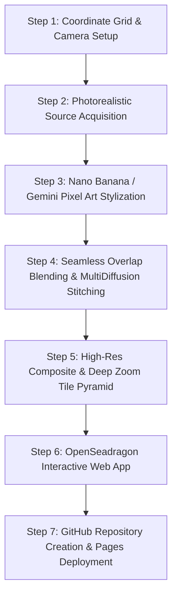

# Casablanca Pixel Art Map (Tiny Casablanca)
## Master Architecture & Implementation Plan

### 1. Executive Summary & Objective
Inspired by Boris Starkov's **tiny.london** and Andy Coenen's **isometric.nyc**, this project creates an interactive, seamless, isometric pixel-art map of **Downtown Casablanca ("Gazaplanca")**, Morocco. The initial target area covers the historic and architectural core: **Place des Nations Unies**, **Place Mohammed V**, the **Wilaya Clock Tower**, **Grand Théâtre de Casablanca**, **Boulevard Mohammed V**, and the gateway to the **Ancienne Medina (Bab Marrakech)**.

The project follows the lessons and principles documented in `res/tiny.londo.Explanation.txt`:
1. **Isometric Projection**: Single orthographic camera tilted at 45° and rotated at 15° (or 45° axonometric) for consistent architectural elevation and street layout.
2. **AI Stylization**: Photorealistic base images transformed into crisp retro pixel art using the Gemini / Nano Banana image engine (`nano-banana-2.1` via Avatarity / Gemini image generation).
3. **Seamless Blending**: Overlapping lattice generation with tent weighting and Poisson/multi-band feathering to eliminate tile seams by construction.
4. **Tile Pyramid & High-Performance Viewer**: Deep Zoom Image (DZI) pyramid rendered via an optimized OpenSeadragon web application.
5. **Production Deployment**: Automated GitHub repository creation and deployment to GitHub Pages.

---

### 2. Geographic Scope: Downtown Casablanca ("Gazaplanca")
- **Target Center**: $33.5933^\circ\text{ N}, -7.6185^\circ\text{ W}$ (Place des Nations Unies & Boulevard Mohammed V)
- **Bounding Box**:
  - North: $33.5980^\circ\text{ N}$ (Port of Casablanca / Ancienne Medina edge)
  - South: $33.5870^\circ\text{ N}$ (Parc de la Ligue Arabe / Wilaya South)
  - West: $33.6250^\circ\text{ W}$ (Boulevard Moulay Youssef / Medina ramparts)
  - East: $33.6120^\circ\text{ W}$ (Marché Central / Avenue Hassan II)
- **Key Landmark Anchors**:
  1. *Place des Nations Unies* (Koubba dome, Hyatt Regency, Bab Marrakech entrance)
  2. *Casablanca Clock Tower (Tour de l'Horloge)*
  3. *Place Mohammed V* (Central illuminated fountain, French Consulate)
  4. *Wilaya of Casablanca* (Neo-Moorish Clock Tower & Courtyard)
  5. *Grand Théâtre de Casablanca* (Christian de Portzamparc modern architecture)
  6. *Boulevard Mohammed V & Tramway Line* (Art Deco & Art Nouveau facades, palm trees)

---

### 3. Step-by-Step Technical Roadmap



#### Step 1: Coordinate Grid & Camera Projection
- Setup an isometric 2.5D coordinate mapping:
  - World coordinates $\to$ Local Cartesian $\to$ 45° tilt, 15° rotation.
  - Pixel resolution: $\sim 0.35$ meters per pixel at native 1:1 scale.
  - Define an $M \times N$ overlapping grid of shots with a 50% overlap margin for seamless boundary interpolation.

#### Step 2: Photorealistic Source Imagery Acquisition
- Acquire calibrated aerial/orthographic source images of downtown Casablanca.
- Maintain consistent lighting: Mediterranean morning/afternoon sunlight with long isometric shadows towards the northwest.
- Normalize scale, elevation, and street orientation across the shot grid.

#### Step 3: Nano Banana & Gemini Image Engine Transformation
- Apply strict prompt conditioning based on the tiny.london discovery ("describe HOW to draw, not WHAT to draw"):
  ```text
  FIDELITY COMES FIRST:
  1. Draw exactly what the source image shows, in identical positions, proportions, and shapes, seen from an orthographic isometric camera tilted 45 degrees.
  2. Retro 16-bit / 32-bit pixel art style, crisp pixel edges, flat geometric shading, no photographic noise.
  3. Palette: Authentic Casablanca Mediterranean palette (warm white and cream Art Deco stucco, terracotta tile, Moroccan zellige tiles, green palm canopies, sandy asphalt, tramway rails).
  4. Preserve structural truth: keep street layouts, building facades, domes, and plazas aligned to the grid.
  ```
- Run generation through Gemini image engine / `nano-banana-2.1` via Avatarity API (`https://avatarity.dev/v1/images/generations`).
- Apply post-quantization: 64-128 color palette reduction, clean edge delineation, flat-fill texture smoothing to avoid photo-copy artifacting.

#### Step 4: Stitching & Seam-Free Blending
- Implement overlapping window blending:
  - Window size: $1024 \times 1024$ px with a $512$ px stride (50% overlap).
  - Tent weighting function $W(x, y) = \text{tent}(x) \cdot \text{tent}(y)$ with smooth ramps to 0 at tile edges.
  - Multi-band / Poisson border correction across adjacent tiles to eliminate brightness/tone discontinuities.
- Boundary pinning (RePaint method) when appending peripheral tiles so that new areas seamlessly grow out of completed ones.

#### Step 5: Multi-Resolution Tile Pyramid (Deep Zoom / DZI)
- Generate a multi-resolution image pyramid:
  - Format: Deep Zoom Image (`.dzi` XML metadata + `tiles_files/{zoom}/{x}_{y}.webp|png`).
  - Tile size: $256 \times 256$ pixels (or $512 \times 512$).
  - Zoom levels: Level 0 (thumbnail overview $\sim 256 \times 256$) up to Level $K$ (full native pixel-art resolution).
  - WebP compression with lossless or 95% quality for ultra-fast browser loading.

#### Step 6: Interactive Web Application
- **Engine**: OpenSeadragon customized with pixelated rendering (`image-rendering: pixelated; image-rendering: crisp-edges`).
- **UI Architecture**:
  - Sleek retro-modern HUD with Casablanca aesthetic (subtle Moroccan geometric motifs, dark glassmorphism).
  - Interactive Landmark Pins: Clickable pins on Tour de l'Horloge, Wilaya, Grand Théâtre, Place des Nations Unies, Tramway.
  - Landmark Directory / Search: Quick-fly to any landmark with smooth pan/zoom animation.
  - Coordinate & Scale HUD: Real-time display of cursor coordinates, zoom multiplier, and physical scale.
  - Minimap / Radar Overview: Live viewport locator.
  - Filter / View Modes: Day / Sunset / Night mode color overlays or pixel grid toggle.
  - Fully responsive for desktop and mobile.

#### Step 7: GitHub Setup, CI/CD, & GitHub Pages Deployment
- Initialize Git repository at `E:\((_atWork_))\PixelArt-Map`.
- Ensure strict security: `.gitignore` excluding API keys, caches, temporary files.
- Create remote GitHub repository under authenticated account `loumizhu` via `gh repo create`.
- Deploy to GitHub Pages (or GitHub Actions static pages) so the app is live on `https://loumizhu.github.io/casablanca-pixel-map`.

---

### 4. Review & Sign-Off Checklist for Claude Desktop
- [x] Alignment with tiny.london mathematical & architectural methodology.
- [x] Neighborhood boundaries and landmark selection accurately reflecting Casablanca downtown.
- [x] Fallback handling for API calls (Gemini local engine + Avatarity nano-banana-2.1).
- [x] Seam-free multi-window blending algorithm.
- [x] Tile pyramid compatibility with OpenSeadragon.
- [x] Autonomous end-to-end execution path.
